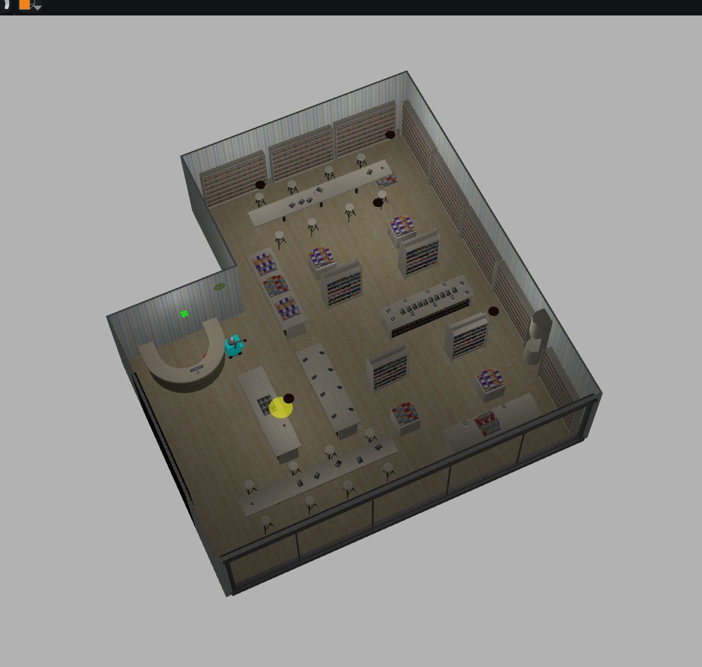
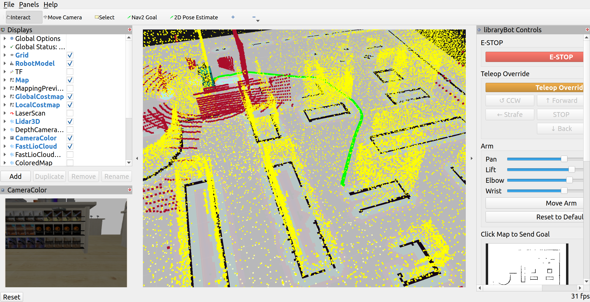

# libraryBot

A ROS 2 Humble + Gazebo Classic 11 simulation of an autonomous library
robot: a holonomic (mecanum) base with a side-mounted 4-DOF arm, a 3D
lidar, an IMU, and a RealSense D435i depth camera, navigating a library
floor plan (derived from `aws-robomaker-bookstore-world`) with Nav2 and
FAST-LIO2 localization.




Full internals (FAST-LIO2 details, control panel, config reference,
troubleshooting, manual testing) are in **[docs/GUIDE.md](docs/GUIDE.md)**.

## Requirements

- Ubuntu 22.04, ROS 2 Humble (`ros-humble-desktop`)
- Gazebo Classic 11
- Everything else (Nav2, robot_localization, FAST-LIO2 overlay, Python
  deps) is installed by `build.sh` below.

## Build

```bash
git clone <this repo> ~/libraryBot
cd ~/libraryBot
./build.sh
```

Builds the FAST-LIO2 overlay workspace (`~/fastlio_ws`) and this repo's
`ros2_ws`. Re-run anytime; already-built pieces are skipped. Use
`./build.sh --skip-apt` if system packages are already installed or you
don't have sudo.

## Run

Every terminal, first:

```bash
source /opt/ros/humble/setup.bash
source ~/fastlio_ws/install/setup.bash
source ~/libraryBot/ros2_ws/install/setup.bash
```

Start the simulation (Gazebo + robot + RViz with the control panel):

```bash
bash ~/libraryBot/ros2_ws/src/libbot_bringup/scripts/run_simulation.sh headless:=false rviz:=true
```

Same arguments as `ros2 launch libbot_bringup simulation.launch.py`, just
wrapped so **Ctrl-C actually tears the whole stack down** -- `ros2
launch`'s own SIGINT handling never reliably reaches gzserver, and never
reaches a mapping/localization/navigation stack started via
`switch_mode.sh` at all (each is its own separate, detached `ros2
launch`, not a child of this one). If you run the bare `ros2 launch
libbot_bringup simulation.launch.py` command directly instead, run
`switch_mode.sh stop` afterward to be sure everything's actually down.

Switch modes (also available as buttons in the RViz control panel):

```bash
bash ~/libraryBot/ros2_ws/src/libbot_bringup/scripts/switch_mode.sh mapping
bash ~/libraryBot/ros2_ws/src/libbot_bringup/scripts/switch_mode.sh localization /path/to/map.yaml
bash ~/libraryBot/ros2_ws/src/libbot_bringup/scripts/switch_mode.sh navigation
bash ~/libraryBot/ros2_ws/src/libbot_bringup/scripts/switch_mode.sh stop
```

Save a map after driving around in mapping mode, then convert it for Nav2:

```bash
ros2 service call /map_save std_srvs/srv/Trigger
ros2 run libbot_fastlio pcd_to_2d_map.py ~/libraryBot/ros2_ws/src/libbot_fastlio/pcd_maps/latest.pcd my_map_name
```

If anything's still running after Ctrl-C (e.g. you killed the terminal
instead of Ctrl-C-ing):

```bash
bash ~/libraryBot/ros2_ws/src/libbot_bringup/scripts/switch_mode.sh stop
pkill -9 -f "ros2 launch"; pkill -9 gzserver; pkill -9 gzclient; pkill -9 rviz2
```

## Repository layout

```
ros2_ws/src/
├── libbot_description      URDF/xacro: chassis, wheels, arm, sensors, ros2_control
├── libbot_gazebo            Library world, spawn launch, props
├── libbot_control           Drive/arm controllers (ros2_control)
├── libbot_fastlio           FAST-LIO2 mapping/localization, EKF, map tools
├── libbot_navigation        Nav2 params + launch + RViz config
├── libbot_perception        Lidar/scan processing
├── libbot_rviz_plugins      RViz control panel
└── libbot_bringup           Top-level launch files, switch_mode.sh
```

See **[docs/GUIDE.md](docs/GUIDE.md)** for what each piece does, the
config reference, and troubleshooting.
