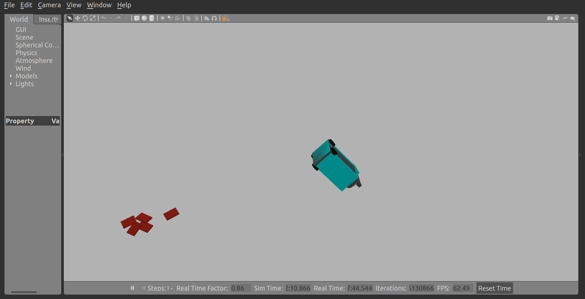

# libraryBot

A ROS 2 Humble + Gazebo Classic 11 simulation of an autonomous library
robot: a holonomic (mecanum) base with a side-mounted 4-DOF pick/place
arm, a 3D lidar, an IMU, and a RealSense D435i depth camera, navigating a
library floor plan (derived from `aws-robomaker-bookstore-world`) with
Nav2 and picking books up off shelves with the arm.



## What's simulated vs. simplified

- **Grasping**: no fingers/moving gripper joint. `libbot_gazebo_plugins`'
  link-attacher plugin teleports a book model onto `gripper_link` each
  physics step on pick (a physics `fixed` joint between two independent
  models was unstable -- see git history if you need the details), not a
  real contact-based grasp.
- **Drivetrain**: propulsion is `gazebo_ros_planar_move` (sets body
  velocity directly), not wheel-ground friction -- mecanum roller
  friction in Gazebo Classic's ODE was too solver-sensitive to reliably
  convert wheel spin into chassis motion. Wheels still spin visually.
- **No bundled map**: build one yourself (see Workflow below) before
  sending Nav2 goals.

## Repository layout

```
ros2_ws/src/
├── libbot_description      URDF/xacro: chassis, mecanum wheels, side-mounted arm, 3D lidar, IMU, RealSense D435i, ros2_control
├── libbot_gazebo            Library world (from aws-robomaker-bookstore-world), spawn launch, book/shelf props
├── libbot_gazebo_plugins    Link-attacher Gazebo world plugin (AttachLink/DetachLink services) for pick/place
├── libbot_control           mecanum_drive_controller + arm_controller + joint_state_broadcaster (ros2_control) config/launch
├── libbot_manipulation      book_catalog.yaml, shelf_catalog.yaml, the Nav2+arm task manager (task_manager_node.py)
├── libbot_localization      robot_localization EKF + FAST-LIO2 (3D lidar-inertial) localization config/launch
├── libbot_mapping           FAST-LIO2 mapping launch, PCD->2D map converter, saved maps/PCDs
├── libbot_navigation        Nav2 params (holonomic DWB tuning) + launch + RViz config
├── libbot_perception        Lidar->2D scan, 3D-lidar-to-Velodyne-format adapter (for FAST-LIO2), self-hit filtering
├── libbot_control_panel     Standalone PyQt5 GUI (legacy/headless fallback)
├── libbot_rviz_plugins      Native RViz2 panel (C++/Qt): the primary control surface, embedded in RViz
└── libbot_bringup           Top-level launch files (simulation.launch.py, autonomy.launch.py, switch_mode.sh)
```

## Requirements

- Ubuntu 22.04, ROS 2 Humble (`ros-humble-desktop`)
- Gazebo Classic 11 + `ros-humble-gazebo-ros-pkgs`, `ros-humble-gazebo-ros2-control`
- `ros-humble-navigation2`, `ros-humble-nav2-bringup`, `ros-humble-nav2-simple-commander`
- `ros-humble-robot-localization`, `ros-humble-realsense2-description`, `ros-humble-pointcloud-to-laserscan`
- `ros-humble-mecanum-drive-controller` (needs a `ros2_controllers` build that includes it)
- `python3-pyqt5`, `python3-opencv`, `ros-humble-cv-bridge`, `python3-yaml`, `python3-open3d` (`pip install open3d`)
- FAST-LIO2: separate overlay workspace, see "3D mapping/localization (FAST-LIO2)" below

## Build

```bash
cd ~/libraryBot/ros2_ws
source /opt/ros/humble/setup.bash
colcon build
source install/setup.bash
```

## Commands

Every terminal, first:

```bash
source /opt/ros/humble/setup.bash
source ~/fastlio_ws/install/setup.bash
source ~/libraryBot/ros2_ws/install/setup.bash
```

Start the simulation:

```bash
ros2 launch libbot_bringup simulation.launch.py headless:=false rviz:=true
```
Brings up Gazebo, the robot, controllers, teleop (hold **LB** on the Xbox
controller to drive), lidar/depth processing, EKF, and RViz with the
"libraryBot Controls" panel docked in it. Nothing owns `map -> odom` and
Nav2 isn't running yet, on purpose.

Switch modes (same as the panel's Mode buttons -- each stops whatever
was running before starting the next, so nothing fights over
`map -> odom`):

```bash
bash ~/libraryBot/ros2_ws/src/libbot_bringup/scripts/switch_mode.sh mapping
bash ~/libraryBot/ros2_ws/src/libbot_bringup/scripts/switch_mode.sh localization /path/to/map.yaml
bash ~/libraryBot/ros2_ws/src/libbot_bringup/scripts/switch_mode.sh navigation
bash ~/libraryBot/ros2_ws/src/libbot_bringup/scripts/switch_mode.sh stop
```

Save the map after driving around in mapping mode (writes
`libbot_mapping/pcd_maps/latest.pcd` -- **not** SIGINT/Ctrl-C, which
doesn't write this path in this FAST_LIO ROS2 port):

```bash
ros2 service call /map_save std_srvs/srv/Trigger
```

Convert the PCD to the 2D map Nav2's costmaps need:

```bash
ros2 run libbot_mapping pcd_to_2d_map.py ~/libraryBot/ros2_ws/src/libbot_mapping/pcd_maps/latest.pcd my_map_name
```
Writes `my_map_name.yaml`/`.pgm` into `libbot_mapping/maps/`. Then
`switch_mode.sh localization ~/libraryBot/ros2_ws/src/libbot_mapping/maps/my_map_name.yaml`
-- this also always points `pcd_map_path` at the same `latest.pcd` for
continuous ICP correction. FAST-LIO2 itself has no "localize against a
prior map" mode -- it always runs live SLAM from scratch on startup, so
its own point cloud (FastLioCloud/yellow in RViz) keeps growing
regardless of mode; ICP is what keeps that fresh session's frame aligned
with the map you actually saved, instead of just a one-shot guess at
startup.

Manipulation (arm pick/place on top of navigation):

```bash
ros2 launch libbot_bringup autonomy.launch.py collect_books:=true
```

Kill everything:

```bash
pkill -9 -f "ros2 launch"; pkill -9 gzserver; pkill -9 gzclient; pkill -9 rviz2
pkill -9 -f "robot_state_publisher|ekf_node|teleop_twist_joy|joy_node|lidar_3d_self_filter|pointcloud_to_laserscan|trail_publisher|fastlio_mapping|lidar_3d_velodyne_adapter|fastlio_map_odom_bridge|static_transform_publisher|mapping_preview_node"
```
If anything survives (`ps aux | grep <name>`), `kill -9 <pid>` directly --
pkill's pattern matching occasionally misses.

## 3D mapping/localization (FAST-LIO2)

[FAST-LIO2](https://github.com/hku-mars/FAST_LIO/tree/ROS2) (tightly-
coupled LiDAR-IMU odometry) is both the mapping source and Nav2's
localization source -- chosen over AMCL+SLAM-Toolbox (redundant with a
3D lidar already onboard) and over a full SLAM stack like rtabmap
(heavier than this needs). One-time build, separate overlay workspace:

```bash
mkdir -p ~/fastlio_ws/src && cd ~/fastlio_ws/src
git clone https://github.com/Livox-SDK/Livox-SDK2.git
git clone https://github.com/Livox-SDK/livox_ros_driver2.git
git clone --recursive --branch ROS2 https://github.com/hku-mars/FAST_LIO.git
# Livox-SDK2: cmake -DCMAKE_INSTALL_PREFIX=<prefix> .. && make install
# livox_ros_driver2: cp package_ROS2.xml package.xml; cp -r launch_ROS2/ launch/
#   (CMakeLists.txt hardcodes /usr/local for the SDK -- point find_library/
#   find_path at <prefix> instead if installed elsewhere)
cd ~/fastlio_ws && colcon build --cmake-args -DROS_EDITION=ROS2 -DDISTRO_ROS=humble
```

Notes if you touch this stack:
- `libbot_perception/lidar_3d_velodyne_adapter.py` synthesizes the
  per-point `ring`/`time` fields FAST-LIO2 needs (Gazebo's `ray` sensor
  captures a whole cloud at one instant, no real per-point time).
- `fast_lio_libbot.yaml` needs `publish.map_en: true` -- without it,
  `/map_save` crashes the node with an unhandled PCL exception
  ("Input point cloud has no data!") since nothing else ever populates
  the point buffer it saves.
- `fastlio_map_odom_bridge.py` turns FAST-LIO2's `/Odometry` (its own
  `camera_init` frame) into the `map -> odom` transform Nav2 looks for,
  optionally refined continuously via ICP against a saved PCD
  (`pcd_map_path` arg) instead of relying only on RViz's "2D Pose
  Estimate".
- `mapping.launch.py` also runs `mapping_preview_node.py` (re-projects
  the accumulating map cloud into a live 2D preview, since FAST-LIO2 has
  no live 2D map the way slam_toolbox used to) and two identity static
  transforms (`map -> camera_init`, `map -> odom`) so RViz has something
  to resolve while mapping, before any real map exists.

## Control panel

"libraryBot Controls", a native RViz2 panel (`libbot_rviz_plugins`)
docked in the RViz window `simulation.launch.py` opens. If missing:
`Panels -> Add New Panel -> libbot_rviz_plugins -> LibbotControlPanel`.

- **Status**: sorting state, live pose.
- **E-STOP**: toggle -- deactivates `mecanum_drive_controller` via
  `/libbot/controller_manager/switch_controller` so nothing can move the
  base regardless of who's publishing commands. Doesn't cancel an
  in-flight Nav2 goal.
- **Camera**: opens `rqt_image_view` in its own process/window (a second
  RViz `Image` display GL context crashed rviz2 on this project's dev
  GPU -- if yours handles multiple GL contexts fine, an RViz Image
  display works too).
- **Mode**: Map/Localize/Navigate buttons, see Commands above.
- **Map dropdown**: pick a saved map, or "Save Map As..." to name one.

### Xbox controller teleop

Holonomic driving, deadman-switched (`libbot_control/config/xbox_holonomic.yaml`):

| Input | Action |
| --- | --- |
| Hold LB | Deadman switch -- robot only moves while held |
| Left stick | Forward/back, strafe left/right |
| Right stick left/right | Rotate in place |
| Hold LB + RB | Turbo speed |

Publishes on `/libbot/mecanum_drive_controller/reference_unstamped`,
same topic Nav2 and the panel use. If not detected: `ls /dev/input/js*`.

## Configuration reference

| What | File |
| --- | --- |
| Chassis/wheel dimensions, mass | `libbot_description/urdf/base/base.urdf.xacro` |
| Mast height/radius | `libbot_description/urdf/base/payload_platform.urdf.xacro` |
| Nav2 planning footprint radius | `libbot_navigation/config/nav2_params.yaml` (`robot_radius`) -- must stay >= chassis half-diagonal |
| 3D lidar channels/rate/range | `libbot_description/urdf/sensors/lidar_3d.urdf.xacro` |
| IMU noise | `libbot_description/urdf/sensors/imu.urdf.xacro` |
| Depth camera resolution/rate/range | `libbot_description/urdf/sensors/depth_camera_gazebo.urdf.xacro` |
| Mecanum kinematics | `libbot_control/config/controllers.yaml` (`kinematics.*`) |
| Canonical velocity command topic | `/libbot/mecanum_drive_controller/reference_unstamped` |
| Spawn location | `libbot_gazebo/launch/spawn_robot.launch.py` args `x`/`y`/`yaw` |
| EKF sensor fusion weights | `libbot_localization/config/ekf.yaml` |
| FAST-LIO2 tuning, map save path | `libbot_localization/config/fast_lio_libbot.yaml` |
| Nav2: velocity/accel limits, critics, costmaps, BT | `libbot_navigation/config/nav2_params.yaml` |
| Books / approach poses | `libbot_manipulation/config/book_catalog.yaml` -- must match `library.world` |
| Shelf locations / approach poses | `libbot_manipulation/config/shelf_catalog.yaml` |
| Arm joint limits/mount, gripper | `libbot_description/urdf/arm/arm.urdf.xacro` |
| Arm trajectory controller | `libbot_control/config/controllers.yaml` (`arm_controller`) |

### Adding a book/shelf

Book: add a prop `<include>` to `library.world`, then a matching entry
(same `name`, `pose`, `approach_pose`) to `book_catalog.yaml`.
Shelf: add an entry to `shelf_catalog.yaml` with `name` (matching
`library.world`), `pose`, `approach_pose` -- not automatically
collision-checked against furniture.

## Troubleshooting

**"Failed to bring up all requested nodes"** -- `nav2_lifecycle_manager`
startup race under load, not a config error. Just re-run the command;
check `free -h` if it keeps happening.

**Robot stops responding after a lot of manual testing** -- check
`free -h`; stray processes from repeated `ros2 launch` Ctrl-C's add up.
Kill strays (see Commands above) and relaunch.

**Robot won't move, topics/services look fine** -- probably driven into
a wall/furniture. Check `/libbot/model_states` for its actual pose.

**RViz shows nothing while mapping** -- restart RViz fresh after any
sim restart; a stale TF buffer from a prior `robot_state_publisher`
instance is a known rviz2 quirk, not a config bug.

**Duplicate processes fighting each other** (garbled joystick input,
`TF_REPEATED_DATA` spam) -- multiple `ros2 launch` invocations left
processes running simultaneously. `ps aux | grep <node_name>`, kill all
but one instance.

## Manual testing cheatsheet

```bash
# Drive the robot directly (bypasses Nav2)
ros2 topic pub /libbot/mecanum_drive_controller/reference_unstamped geometry_msgs/msg/Twist \
  "{linear: {x: 0.3, y: 0.0, z: 0.0}, angular: {x: 0.0, y: 0.0, z: 0.0}}" -r 20

# Send a Nav2 goal from the CLI
ros2 action send_goal /navigate_to_pose nav2_msgs/action/NavigateToPose \
  "{pose: {header: {frame_id: 'map'}, pose: {position: {x: 1.3, y: 2.8}, orientation: {w: 1.0}}}}"

# Move the arm directly (bypasses the task manager)
ros2 action send_goal /libbot/arm_controller/follow_joint_trajectory control_msgs/action/FollowJointTrajectory \
  "{trajectory: {joint_names: [shoulder_pan_joint, shoulder_lift_joint, elbow_joint, wrist_pitch_joint], \
    points: [{positions: [0.3, -0.5, 0.8, 0.2], time_from_start: {sec: 2}}]}}"

# Weld/release a book directly (bypasses the task manager)
ros2 service call /libbot/attach_link libbot_gazebo_plugins/srv/AttachLink \
  "{model1_name: libbot, link1_name: gripper_link, model2_name: BookE_01_001, link2_name: link}"
ros2 service call /libbot/detach_link libbot_gazebo_plugins/srv/DetachLink \
  "{model1_name: libbot, link1_name: gripper_link, model2_name: BookE_01_001, link2_name: link}"
```
