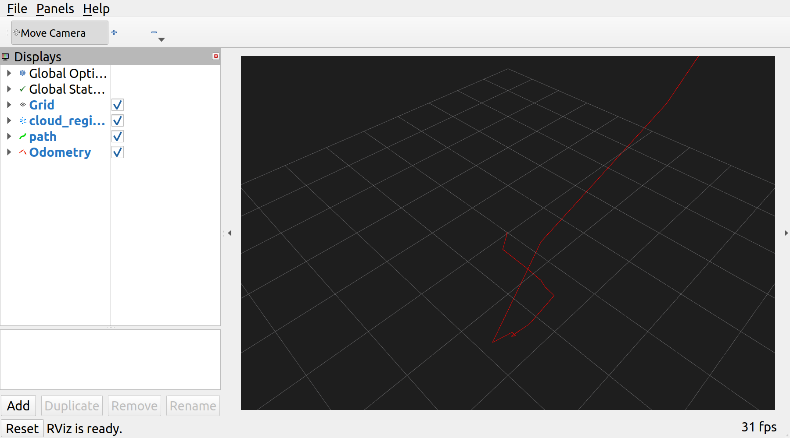

# libraryBot

A ROS 2 Humble + Gazebo Classic 11 simulation of an autonomous library
robot: a holonomic (mecanum) base with a side-mounted 4-DOF pick/place
arm, a 3D lidar, an IMU, and a RealSense D435i depth camera, navigating a
library floor plan (derived from `aws-robomaker-bookstore-world`) with
Nav2 and picking books up off shelves with the arm.

```
Nav2 drives to a book --arm reaches + grips--> carry --Nav2--> shelf --place--> repeat
```


## What's simulated vs. simplified

Read this before you go looking for something that "should" be there:

- **Grasping**: the arm has no fingers/moving gripper joint and grasping
  isn't contact/friction-based. `libbot_gazebo_plugins`' link-attacher
  plugin welds a book model's link to `gripper_link` on pick (a
  kinematic pose-follow every physics step, not a physics joint -- see
  "Manipulation (pick/place)" below for why) and releases it on place.
- **Drivetrain**: the base is modeled as 4 mecanum wheels visually, but
  actual propulsion comes from Gazebo's `planar_move` plugin (sets body
  velocity directly), not wheel-ground friction. See "Drivetrain design
  note" below for why, and for the practical consequence (soft velocity
  limits in `nav2_params.yaml`).
- **Bundled map**: `libbot_mapping/maps/library.yaml` is a small partial
  map from a short initial mapping run near the intake desk, checked in
  so the repo works out of the box. It does **not** cover the whole
  library. Build a full one yourself (see "Mapping" below) before sending
  Nav2 goals across the whole floor plan.

## Repository layout

```
ros2_ws/src/
├── libbot_description      URDF/xacro: chassis, mecanum wheels, side-mounted arm, 3D lidar, IMU, RealSense D435i, ros2_control
├── libbot_gazebo            Library world (from aws-robomaker-bookstore-world), spawn launch, book/shelf props
├── libbot_gazebo_plugins     Link-attacher Gazebo world plugin (AttachLink/DetachLink services) for pick/place
├── libbot_control            mecanum_drive_controller + arm_controller + joint_state_broadcaster (ros2_control) config/launch
├── libbot_manipulation        book_catalog.yaml, shelf_catalog.yaml, the Nav2+arm task manager (task_manager_node.py)
├── libbot_localization        robot_localization EKF + AMCL config/launch, plus FAST-LIO2 3D lidar-inertial localization
├── libbot_mapping             SLAM Toolbox config/launch + the bundled default map
├── libbot_navigation           Nav2 params (holonomic DWB tuning) + launch + RViz config
├── libbot_perception            Lidar->2D scan, 3D-lidar-to-Velodyne-format adapter (for FAST-LIO2)
├── libbot_control_panel           Standalone PyQt5 GUI (legacy/headless fallback -- see "Control panel")
├── libbot_rviz_plugins             Native RViz2 panel (C++/Qt): the primary control surface, embedded in RViz
└── libbot_bringup                  Top-level launch files (simulation.launch.py, autonomy.launch.py)
```

## Requirements

Everything below is already installed if you're on the machine this was
built on. For a fresh machine:

- Ubuntu 22.04, ROS 2 Humble (`ros-humble-desktop`)
- Gazebo Classic 11 + `ros-humble-gazebo-ros-pkgs`, `ros-humble-gazebo-ros2-control`
- `ros-humble-navigation2`, `ros-humble-nav2-bringup`, `ros-humble-nav2-simple-commander`
- `ros-humble-slam-toolbox`, `ros-humble-robot-localization`
- `ros-humble-realsense2-description`, `ros-humble-pointcloud-to-laserscan`
- `ros-humble-mecanum-drive-controller` (backported into this Humble build; if your Humble doesn't have it, you'll need a newer `ros2_controllers` or to swap the controller)
- `python3-pyqt5`, `python3-opencv`, `ros-humble-cv-bridge`, `python3-yaml`

## Build

```bash
cd ~/libraryBot/ros2_ws
source /opt/ros/humble/setup.bash
colcon build
source install/setup.bash
```

## Quick start

One command to bring up the world/robot, then drive the workflow from
the control panel embedded in RViz:

```bash
ros2 launch libbot_bringup simulation.launch.py
```

This starts Gazebo, the robot, controllers, lidar processing, the EKF,
and RViz (with the "libraryBot Controls" panel docked in it) -- but
**does not** start SLAM or AMCL yet. Nothing owns `map -> odom` and Nav2
isn't running until you say so, on purpose (see "Map, localize, navigate
workflow" below for why and how).

Useful variations:

```bash
# No Gazebo GUI (faster, for servers / repeated testing)
ros2 launch libbot_bringup simulation.launch.py headless:=true

# Skip RViz too
ros2 launch libbot_bringup simulation.launch.py rviz:=false
```

## Map, localize, navigate workflow

The control panel's **Mode** section has three buttons, meant to be used
in order. Each one stops whatever the previous stage was running first
(via `libbot_bringup/scripts/switch_mode.sh`), so you never end up with
two things fighting over the `map -> odom` transform:

1. **1. Start Mapping** -- starts SLAM Toolbox. Drive the robot around
   with the Xbox controller (see "Xbox controller teleop" below) until
   the Map display in RViz looks complete, then click **Save Map**
   (writes over `libbot_mapping/maps/library.yaml`/`.pgm`).
2. **2. Start Localization** -- stops SLAM, starts AMCL against the
   saved map. Check RViz: the particle cloud (enable the `AMCLParticles`
   display) should converge tightly around the robot's actual pose. If
   it doesn't, use RViz's **2D Pose Estimate** tool to give AMCL a nudge
   in the right place.
3. **3. Start Navigation** -- brings up Nav2 (planner/controller/
   behaviors) on top of the localization from step 2. Add
   `collect_books:=true` (`ros2 launch libbot_bringup autonomy.launch.py
   collect_books:=true`, not currently wired to a panel button) to also
   start the arm task manager, which is when the robot starts driving to
   books and picking them up -- see "Manipulation (pick/place)" below.

You can also drive any single stage directly from the CLI instead of the
panel (useful for scripting): `ros2 launch libbot_mapping
mapping.launch.py`, `ros2 launch libbot_localization
localization.launch.py use_amcl:=true map:=/path/to/map.yaml`, or `ros2
launch libbot_bringup autonomy.launch.py` respectively -- these are
exactly what the panel buttons and `switch_mode.sh` call. The bundled
`libbot_mapping/maps/library.yaml` only covers a small area near the
intake desk, so a real run of the full workflow (map the whole library
first) is worth doing before relying on Nav2 goals across the floor
plan.

### Two-stage bringup / why Nav2 is its own command

Nesting Nav2's `controller_server` + `nav2_lifecycle_manager` inside
another launch file's `TimerAction`/`IncludeLaunchDescription` chain hit
a real, load-sensitive race during testing: `lifecycle_manager` would
call `configure()` on a Nav2 server before that server had finished
loading its own plugins (DWB's critics, in particular), and
`lifecycle_manager` does not retry -- it aborts with `Failed to bring up
all requested nodes`, even though the server itself finishes configuring
correctly a moment later. The same race can hit AMCL/map_server's
lifecycle manager under heavy load too. Both `navigation.launch.py` and
`localization.launch.py` already start their lifecycle managers a few
seconds after their managed nodes to give this a head start, and
`autonomy.launch.py`/the panel's mode buttons launch Nav2 as an
independent top-level `ros2 launch` invocation rather than nested inside
`simulation.launch.py`, which was reliable in testing. If you ever see
that error, it's this race, not a config problem -- **just click the
button (or run the command) again**; check `free -h` first if it keeps
happening (see Troubleshooting).

## Manipulation (pick/place)

```bash
ros2 launch libbot_bringup autonomy.launch.py collect_books:=true
```

`libbot_manipulation`'s `task_manager_node.py` loops over
`book_catalog.yaml`: Nav2-drives to a book's `approach_pose`, sends a
scripted `FollowJointTrajectory` goal to `/libbot/arm_controller` (canned
stow/reach/lift joint poses, not IK -- the arm's geometry only needs to
plausibly reach across a desk in front of the robot), calls
`/libbot/attach_link` to weld the book to `gripper_link`, Nav2-drives to
a shelf from `shelf_catalog.yaml`, calls `/libbot/detach_link`, and
teleports the book onto the shelf pose via `/libbot/set_entity_state`.

Three things worth knowing if you touch this stack:

- **The arm is side-mounted**, off the chassis's `-Y` face
  (`arm_base_joint` in `arm.urdf.xacro`), not perched on the front-top
  edge like an early version of this robot -- that placement visually
  collided with the front fascia and didn't read as a real mounted arm.
- **`gripper_link` has to survive as a real Gazebo link.** Gazebo
  Classic's URDF->SDF conversion lumps any `fixed`-jointed child link's
  geometry into its parent, and `<disableFixedJointLumping>` (the usual
  fix) isn't honored by every sdformat build. `gripper_link` is attached
  via a zero-range `revolute` joint instead -- functionally rigid, never
  lumped regardless of sdformat quirks.
- **Grasping is a kinematic pose-follow, not a physics joint.** The
  link-attacher plugin (`libbot_gazebo_plugins`) tried an ODE `fixed`
  joint between the gripper and a book first; a dynamically created
  joint between two independent top-level models turned out to resonate
  into a runaway tumble within a couple of physics steps, no matter how
  mass/velocity/anchor were fixed up. `OnWorldUpdate` instead teleports
  the book to track the gripper's pose every physics step while the
  book stays a static body -- there's no constraint solver involved, so
  nothing to destabilize.

## 3D localization (FAST-LIO2)

The 3D lidar (`/libbot/lidar_3d/points`) is otherwise only ever
flattened to 2D via `pointcloud_to_laserscan` for AMCL/Nav2's costmaps.
To actually see 3D lidar-inertial localization working, this repo wires
up [FAST-LIO2](https://github.com/hku-mars/FAST_LIO/tree/ROS2) (tightly-
coupled LiDAR-IMU odometry via an iterated Kalman filter + incremental
k-d tree) instead of a full SLAM stack like rtabmap -- rtabmap's GTSAM
factor-graph backend is real weight for what's a fairly small, bounded
environment, and the goal here includes eventually running on a Jetson
Nano Super, where that weight matters.



```bash
# One-time: build the FAST_LIO ROS2 branch + livox_ros_driver2 (needed
# only for message-type headers -- there's no real Livox hardware here)
# + Livox-SDK2 in a separate overlay workspace:
mkdir -p ~/fastlio_ws/src && cd ~/fastlio_ws/src
git clone https://github.com/Livox-SDK/Livox-SDK2.git
git clone https://github.com/Livox-SDK/livox_ros_driver2.git
git clone --recursive --branch ROS2 https://github.com/hku-mars/FAST_LIO.git
# Livox-SDK2: cmake -DCMAKE_INSTALL_PREFIX=<prefix> .. && make install
# livox_ros_driver2: cp package_ROS2.xml package.xml; cp -r launch_ROS2/ launch/
#   (its CMakeLists.txt hardcodes /usr/local for the SDK -- point the
#   find_library/find_path calls at <prefix> instead if you installed
#   Livox-SDK2 somewhere else)
cd ~/fastlio_ws && colcon build --cmake-args -DROS_EDITION=ROS2 -DDISTRO_ROS=humble

# Every run:
source /opt/ros/humble/setup.bash
source ~/fastlio_ws/install/setup.bash
source ~/libraryBot/ros2_ws/install/setup.bash
ros2 launch libbot_localization localization_3d.launch.py
```

Two adaptations were needed to point FAST-LIO2 (built for real spinning
mechanical lidars) at this project's simulated sensor:

- **No `ring`/`time` per-point fields.** Gazebo's `ray` sensor captures
  the whole cloud at one simulation instant (no real per-point capture
  time to recover), but FAST-LIO2's Velodyne point type needs both.
  `libbot_perception/lidar_3d_velodyne_adapter.py` republishes the cloud
  with both fields synthesized from each point's geometry (`ring` from
  vertical angle bucketed across the lidar's known channel count,
  `time` from horizontal angle mapped across one frame period) on
  `/libbot/lidar_3d/points_velodyne`.
- **IMU-lidar extrinsic** (`libbot_localization/config/fast_lio_libbot.yaml`,
  `extrinsic_T`) is computed directly from the URDF chain (both sensors
  are on fixed, axis-aligned joints relative to `base_link`) rather than
  calibrated, since this is simulation.

FAST-LIO2 publishes its own odometry (`/Odometry`, frame `camera_init`
-> `body`) independent of the EKF's `odom` frame used by the 2D AMCL/Nav2
stack, so it can run alongside `simulation.launch.py` without fighting
over a TF frame -- this is a standalone 3D localization/mapping demo, not
merged into Nav2's costmaps.

## Control panel

The primary control surface is **"libraryBot Controls"**, a native RViz2
panel (`libbot_rviz_plugins`, C++/pluginlib/Qt5) docked directly inside
the RViz window opened by `simulation.launch.py` -- no separate window to
lose track of or click into. It runs its own lightweight `rclcpp::Node`
internally (spun via a `QTimer` calling `rclcpp::spin_some` every 50ms).

- **Status**: current sorting state, active tag/shelf, books sorted total,
  live pose (from the EKF-filtered odometry, `/odometry/filtered`).
- **E-STOP**: toggle button. Unlike a simple "publish zero velocity"
  button (which an Xbox controller or Nav2 continuously re-publishing
  Twists would immediately override), this calls
  `/libbot/controller_manager/switch_controller` to actually deactivate
  `mecanum_drive_controller` in ros2_control while engaged, so the robot
  physically cannot move no matter who is publishing commands. Releasing
  it reactivates the controller. This does **not** cancel a Nav2 goal in
  progress -- Nav2 will keep planning and re-issue commands once the
  controller is back; cancel the goal separately if you need that.
- **Camera**: "Open Camera View" launches `rqt_image_view` in a separate
  window/process pointed at the D435i's color topic -- see "GPU/VRAM
  notes" below for why this isn't just an RViz Image display.
- **Mode**: the Map -> Localize -> Navigate workflow, see "Map, localize,
  navigate workflow" above. Buttons run `switch_mode.sh` via
  `QProcess::startDetached` (so the launched stack survives independently
  of the panel), which stops the previous stage before starting the next.
- **Log**: panel-local event log (not a `/rosout` viewer).

If the panel is ever missing from RViz: `Panels -> Add New Panel ->
libbot_rviz_plugins -> LibbotControlPanel`.

### Xbox controller teleop

Manual driving is done with an Xbox 360 controller (USB wireless dongle,
shows up as `/dev/input/js0`) rather than on-screen buttons -- more
natural for holonomic strafing than a button grid, and it's what's
actually available on this hardware. Start it in its own terminal:

```bash
ros2 launch libbot_control teleop_joy.launch.py
```

Controls (`libbot_control/config/xbox_holonomic.yaml`):

| Input | Action |
| --- | --- |
| Hold LB (left bumper) | Deadman switch -- robot only moves while held |
| Left stick up/down | Forward / backward |
| Left stick left/right | Strafe left / right (holonomic) |
| Right stick left/right | Rotate in place |
| Hold LB + RB | Turbo (faster) speed scale |

It publishes plain `geometry_msgs/Twist` on
`/libbot/mecanum_drive_controller/reference`, the same topic Nav2 and
`teleop_twist_keyboard` use. If the controller isn't detected, check
`ls /dev/input/js*` and `ls -l /dev/input/by-id/` (should show a
`*-joystick` symlink to `js0`).

### Standalone PyQt5 fallback

`libbot_control_panel` (a separate, plain-Python `ros2 run`-able window,
same feature set) still exists for headless boxes or scripting, but is
**off by default** (`simulation.launch.py control_panel:=false`) so you
don't get two copies of the same controls in two separate windows. Run it
explicitly with `ros2 run libbot_control_panel control_panel_node.py` or
`simulation.launch.py control_panel:=true`. Note: in one heavily
remote-desktop'd test environment its buttons did not visibly respond to
synthetic/remote clicks even though the underlying ROS plumbing was
verified correct end-to-end (direct `ros2 topic pub`/`ros2 service call`
always worked) -- this looked like a window-focus/input-routing quirk of
that specific remote display setup, not a bug in the panel's Qt code. The
RViz panel avoids the whole class of problem by living inside a window
you're already interacting with, which is the main reason it's now the
default.

## RViz

`libbot_navigation/rviz/libbot_nav.rviz` (loaded automatically by
`simulation.launch.py`) is set up to look like a real AMR's operator
view, not a bare-bones default:

- **Lidar3D**: the full 3D lidar point cloud, rainbow-colored by height
  (`AxisColor`/`Z`, `Flat Squares`, on by default) -- this is the robot's
  main perception sensor and the most important thing to see moving.
- **GlobalCostmap** / **LocalCostmap**: Nav2's costmaps as `Map` displays
  with `Color Scheme: costmap` (the magenta/cyan cost-gradient look),
  semi-transparent, on by default. Only populate once `autonomy.launch.py`
  is running.
- **Map**, **RobotModel**, **GlobalPlan**/**LocalPlan** paths: on by
  default.
- **DepthCameraPointCloud** (the D435i's raw depth cloud) and
  **CameraColor** (the D435i's RGB image): present but **off by
  default** -- see "GPU/VRAM notes" below for why.
- **TF** and **LaserScan** (the flattened 2D scan): present but off by
  default to reduce visual clutter; toggle on in Displays when debugging.

### GPU/VRAM notes

This stack was developed and tested on a GPU-constrained box (4GB VRAM,
shared with Gazebo's own rendering), and two things reliably broke rviz2
there -- both now reflected as "off by default" above, and worth knowing
about if you hit similar crashes on your own hardware:

- **The `Image` display (`CameraColor`) crashed rviz2 outright**
  (`libGL error: failed to create drawable` -> Ogre `Vertex Buffer: Out
  of memory` -> SIGABRT), independent of the topic's actual bandwidth --
  it's a second GL render target that this particular driver couldn't
  create alongside Gazebo's own GL context. If your GPU handles multiple
  simultaneous GL contexts fine, enable it freely. Otherwise, view the
  camera with `ros2 run rqt_image_view rqt_image_view` instead (its own
  process, own GL context, doesn't compete with rviz2's).
- **The depth camera's raw point cloud** (`DepthCameraPointCloud`) is
  ~307k points/frame (640x480 @ 15Hz) and is heavy enough to strain VRAM
  when rendered alongside the lidar cloud, costmaps, and Gazebo. Enable
  it only when you specifically need 3D geometry from the depth camera;
  lower `width`/`height`/`hz` in
  `libbot_description/urdf/sensors/depth_camera_gazebo.urdf.xacro` if you
  want it on by default.

If rviz2 crashes for you and the log shows `libGL error` or an Ogre
`InternalErrorException`, disable displays one at a time (Image first)
to find the trigger before assuming it's a config problem.

## Configuration reference

Everything you're likely to want to tune, and where it lives:

| What | File |
| --- | --- |
| Chassis/wheel dimensions, mass | `libbot_description/urdf/base/base.urdf.xacro` (`chassis_x/y/z`, `wheel_radius`, `wheel_sep_x/y`) |
| Mast height/radius (overall robot height) | `libbot_description/urdf/base/payload_platform.urdf.xacro` (`mast_height`, `mast_radius`) -- see "Chassis dimensions" below |
| Nav2's planning footprint radius | `libbot_navigation/config/nav2_params.yaml` (`robot_radius`, both costmaps) -- must stay >= the chassis's actual half-diagonal |
| 3D lidar channels/rate/range | `libbot_description/urdf/sensors/lidar_3d.urdf.xacro` macro params, instantiated in `libbot.urdf.xacro` |
| IMU noise | `libbot_description/urdf/sensors/imu.urdf.xacro` |
| Depth camera resolution/rate/range | `libbot_description/urdf/sensors/depth_camera_gazebo.urdf.xacro` macro params |
| Mecanum kinematics (wheel radius, track) | `libbot_control/config/controllers.yaml` (`kinematics.*` -- must match the description's dimensions) |
| Canonical velocity command topic | `/libbot/mecanum_drive_controller/reference_unstamped` (`geometry_msgs/Twist`) -- Nav2, teleop, and the control panel all publish here |
| Spawn location | `libbot_gazebo/launch/spawn_robot.launch.py` args `x`/`y`/`yaw`, also `libbot_bringup/launch/simulation.launch.py` |
| EKF sensor fusion weights | `libbot_localization/config/ekf.yaml` |
| AMCL particle filter tuning | `libbot_localization/config/amcl.yaml` |
| SLAM Toolbox mapping density | `libbot_mapping/config/slam_toolbox_online_async.yaml` |
| Nav2: velocity/accel limits, critics, costmaps, BT | `libbot_navigation/config/nav2_params.yaml` |
| Which books exist / their approach pose | `libbot_manipulation/config/book_catalog.yaml` -- must match book props in `libbot_gazebo/worlds/library.world` |
| Shelf locations / approach poses | `libbot_manipulation/config/shelf_catalog.yaml` |
| Arm joint limits/mount, gripper | `libbot_description/urdf/arm/arm.urdf.xacro` (`arm_base_joint` origin is the side mount point) |
| Arm trajectory controller | `libbot_control/config/controllers.yaml` (`arm_controller`, `joint_trajectory_controller`) |
| 3D localization (FAST-LIO2) tuning | `libbot_localization/config/fast_lio_libbot.yaml` |

### Adding a new book

1. Add a book prop instance to `library.world` (copy an existing
   `BookE_01_*`/`BookF_01_*`/etc. `<include>` block, give it a unique
   `name`, place it on a shelf).
2. Add a matching entry to `libbot_manipulation/config/book_catalog.yaml`
   with that same `name`, its `pose` (where the book actually rests, for
   `set_entity_state` after placing), and an `approach_pose` (where Nav2
   drives the base to before the arm reaches for it).

### Adding a new shelf

Add an entry to `libbot_manipulation/config/shelf_catalog.yaml` with
`name` (an existing shelf model name from `library.world`), `pose`
(where a placed book should rest on it), and `approach_pose` (where Nav2
drives to). Double check a new `approach_pose` doesn't land inside
furniture -- these aren't automatically collision-checked.

## Chassis dimensions

The robot stands ~1.0m (about 3.3 ft) tall: a tall, boxy mecanum chassis
(0.50m x 0.40m footprint, 0.75m tall, `base.urdf.xacro`) topped with a
short, wide `sensor_mast_link` puck (0.12m tall, 0.14m radius,
`payload_platform.urdf.xacro`) that the 3D lidar sits almost flush on
top of. This is a deliberate restyle from an earlier version of this
robot, which had a short 0.18m chassis with a thin 0.85m mast on top --
visually that read as "a pole stuck through a skateboard" rather than a
real service-robot body (styled after commercial cleaning/delivery AMRs
like the Peppermint SD20: one tall, thick shell, lidar mounted almost
flush on top, no visible shaft). The D435i depth camera moved with it,
now mounted on the chassis's own upper-front face (`libbot.urdf.xacro`)
instead of partway up the old mast.

The mast/puck is still kept narrower than the base (28cm diameter vs.
the base's 40-50cm footprint) so it never becomes the binding constraint
for how wide a gap the robot can fit through -- the base footprint is
still what Nav2's costmap `robot_radius` (0.33m) plans against. That
0.33m was checked against this world's narrowest shelf-to-shelf spacing
(~1.51m center-to-center between facing shelf rows in `library.world`,
leaving roughly 1.1-1.2m of walkable aisle once shelf depth is
subtracted) with comfortable margin. If you widen the chassis or add
anything that sticks out past the base footprint (like a wider puck),
re-check against that aisle number and bump `robot_radius` in
`nav2_params.yaml` to match, or Nav2 will plan paths the robot can't
physically fit through.

Because the chassis is now most of the robot's height, the 3D lidar's
mount height dropped from the original mast-top design; it was later
raised again (`libbot.urdf.xacro`'s `libbot_lidar_3d` instantiation) once
the mast/chassis fascia turned out to sit close enough underneath it to
clip the lidar's own downward field of view -- if you change the mast or
arm geometry, re-check that the lidar's `-vfov_deg/2` ray still clears
whatever's directly below it.

## Drivetrain design note

Gazebo Classic's anisotropic wheel friction (the `fdir1`/`mu1`/`mu2`
trick used to simulate mecanum rollers) turned out to be too sensitive to
ODE solver iteration count and contact stiffness to reliably convert
commanded wheel spin into actual chassis motion -- wheels would spin at
the mathematically correct rate while the chassis barely translated, and
yaw was disproportionately damped versus x/y translation. Real holonomic
propulsion here comes from `gazebo_ros_planar_move`, which sets the
body's velocity directly each physics step; the wheel joints (and
`mecanum_drive_controller`) are kept and driven by the same command topic
purely so the wheels *look* right in Gazebo/RViz.

Two practical consequences, both already accounted for in the shipped
configs:

- `libbot_navigation/config/nav2_params.yaml`'s DWB velocity/acceleration
  limits are set noticeably below what the base could command in
  principle, because the plant still isn't perfectly linear (small
  commands are proportionally more damped than large ones, closer to a
  static-friction breakaway effect than clean velocity tracking). If you
  improve the drivetrain, retune these upward.
- `libbot_description/urdf/base/base.urdf.xacro` has no wheel collision
  geometry at all -- ground support comes from a single flat
  `skid_plate_link` with near-zero friction, added specifically because
  wheel-level contacts (even with very low friction) resisted the
  imposed body velocity enough to starve Nav2's progress checker on real
  goals.

## Troubleshooting

**"Failed to bring up all requested nodes" from `autonomy.launch.py` or
`simulation.launch.py`** See "Two-stage bringup" above -- it's a
`nav2_lifecycle_manager` startup race under system load (it calls
`configure()` before the target node's lifecycle services are ready and
doesn't retry), not a config error. Both `navigation.launch.py`'s and
`localization.launch.py`'s lifecycle managers are already started a few
seconds after their managed nodes to give this a head start, but under
heavy enough load it can still happen. Re-run the command; check `free
-h` first if it keeps happening (see below).

**Simulation seems to freeze / robot stops responding to commands after
a lot of manual testing** Check `free -h`. Each `ros2 launch` you
Ctrl-C often leaves the odd process behind (this is a `ros2 launch`/DDS
process-group quirk, not specific to this repo); after many restarts
they add up and start starving everything else of RAM/CPU. Find and
kill strays with e.g. `pkill -9 -f gzserver` and friends, then relaunch.

**Robot won't move even though topics/services all look correct** You
may have driven it into a wall or a piece of furniture during manual
testing. Check `/libbot/model_states` for its actual pose (it's easy to
drift a long way from spawn during ad hoc teleop testing) and either
drive it back out or respawn.

**AMCL/Nav2 can't plan to a goal you know is reachable** The bundled
map is small and partial (see "What's simulated vs. simplified"). Build
a fuller map first (see "Mapping mode").

## Manual testing cheatsheet

```bash
# Drive the robot directly (bypasses Nav2)
ros2 topic pub /libbot/mecanum_drive_controller/reference_unstamped geometry_msgs/msg/Twist \
  "{linear: {x: 0.3, y: 0.0, z: 0.0}, angular: {x: 0.0, y: 0.0, z: 0.0}}" -r 20

# Send a Nav2 goal from the CLI
ros2 action send_goal /navigate_to_pose nav2_msgs/action/NavigateToPose \
  "{pose: {header: {frame_id: 'map'}, pose: {position: {x: 1.3, y: 2.8}, orientation: {w: 1.0}}}}"

# Move the arm directly (bypasses the task manager)
ros2 action send_goal /libbot/arm_controller/follow_joint_trajectory control_msgs/action/FollowJointTrajectory \
  "{trajectory: {joint_names: [shoulder_pan_joint, shoulder_lift_joint, elbow_joint, wrist_pitch_joint], \
    points: [{positions: [0.3, -0.5, 0.8, 0.2], time_from_start: {sec: 2}}]}}"

# Weld a book to the gripper directly (bypasses the task manager)
ros2 service call /libbot/attach_link libbot_gazebo_plugins/srv/AttachLink \
  "{model1_name: libbot, link1_name: gripper_link, model2_name: BookE_01_001, link2_name: link}"
ros2 service call /libbot/detach_link libbot_gazebo_plugins/srv/DetachLink \
  "{model1_name: libbot, link1_name: gripper_link, model2_name: BookE_01_001, link2_name: link}"
```
